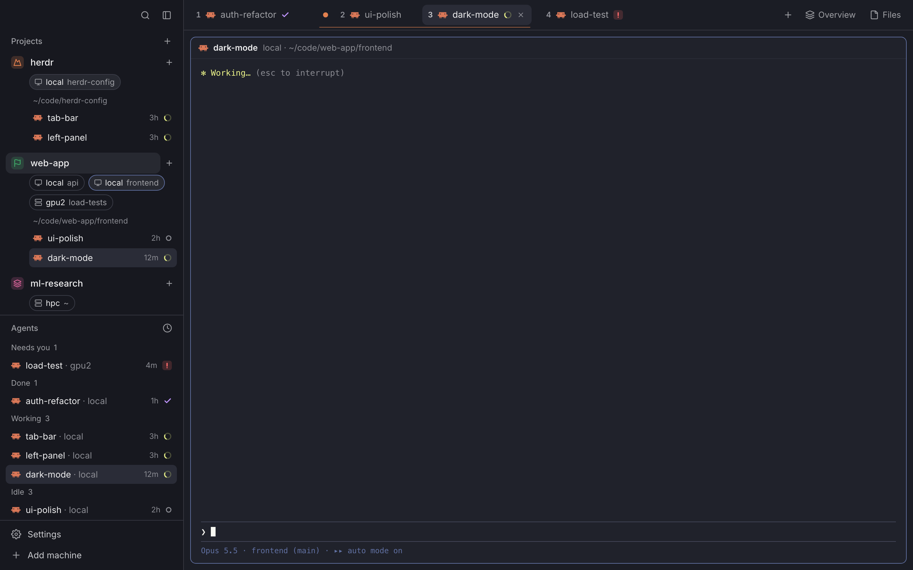

# herdr-config

English | [中文](README.zh-CN.md)

**My [Herdr](https://herdr.dev) desktop workspace for running Claude Code, Codex, and Antigravity (`agy`) side by side across Macs, Linux servers, and Slurm clusters.**

Projects span machines and directories. The top bar shows one project at a time, grouped by folder, while keyboard shortcuts, cross-agent hooks, and shared skills tie every local and remote session together. One command installs everything on a Mac or remote host; one command saves changes back.



> **Try the interactive mock in your browser:** [zhuconv.github.io/herdr-config](https://zhuconv.github.io/herdr-config/) — drag tabs onto each other to split, click a project's **+**, or right-click tabs and panes.

---

## Agent Support at a Glance

| Capability | Claude Code (`cc`) | Codex | Antigravity (`agy`) |
|---|:---:|:---:|:---:|
| Live session title in tabs, pane headers & Agents list | ✅ (auto-named via Haiku) | ✅ (workspace suffix stripped) | ✅ (via `agy-title` hook) |
| Rename tab → renames the underlying conversation | ✅ | Tab label | ✅ |
| `⌃Tab` switcher cards with last prompt & reply | ✅ | ✅ (+ pending approval ask) | ✅ |
| Ring / toast on finish or input needed + `⌘G` jump | ✅ (incl. `claude attach`) | ✅ | ✅ |
| `⌘⇧T` reopens closed tabs & resumes exited sessions | ✅ (`--resume`) | Tab reopen | ✅ (`--conversation`) |
| Remote fleet hooks via `./install.sh --remote` | ✅ | ✅ (`--no-daemon` + auto-trust) | ✅ |
| Unified Artifact workspace ([Yours / `artifact-site`](https://github.com/lexmount/artifact-site)) | ✅ (all `/auth` accounts) | ✅ | ✅ |
| Status line: model · context used · folder & git · effort · plan usage | ✅ (`statusline.sh`, weekly limit) | ✅ (built-in items, Catppuccin Mocha theme) | ✅ (`statusline.sh`, weekly or 5-hour limit) |

---

## What It Does

### 1. Projects, Tabs & Window Layout

| Feature | What it gives you |
|---|---|
| **Cross-machine Projects panel** | Group *machine · directory* pairs into projects (subdirectories inherit their parent; unfiled paths go to *Unsorted*). Click a project to fold it, click a folder pill to list conversations, or drag pills between projects. |
| **Focused project tab bar** | Shows only the active project's tabs across every space and machine, grouped by directory (marked with a color dot and underline when a folder has 2+ tabs) and numbered for `⌘1–⌘9`. |
| **Drag-to-split panes** | Drop one tab onto another for a side-by-side split (hold `⌥` to stack vertically), or onto an edge to reorder. Drag a name out, right-click, or use the pane header button to unsplit. |
| **New directory on any machine** | Click **+** on a project row (or right-click → *New directory…*) to pick a machine and path with live remote Tab-completion, create the folder, register it, and start an agent there. |
| **ActivityWatch time tracking** | Sets Herdr's OS window title to `Herdr — <project> · <conversation> · <program>` so a single regex rule per project (`^Herdr — paper( ·\|$)` ) tracks active time accurately. |

### 2. Multi-Agent Session UX (`cc` · `Codex` · `agy`)

| Feature | What it gives you |
|---|---|
| **One name per agent** | Pane headers, tabs, Agents list, `⌃Tab`, and notifications all use the session's real name. Double-click a single-agent Claude or `agy` tab to rename the session itself; new Claude sessions auto-summarize their first prompt in 2–3 words via Haiku. |
| **`⌃Tab` context cards** | Switches across panes in MRU order—including background sessions, shells, and the other half of a split—showing each agent's latest prompt and reply (plus what an awaiting Codex wants to run). |
| **`⌘G` jump with border halo** | Jumps from any macOS app (via Raycast) to the agent that most recently rang. A color-matched glow spreads around the target pane's outer border and fades so you spot it immediately inside a split tab. |
| **Resume exited agents (`⌘⇧T`)** | Exiting a standalone agent (`Ctrl+C`, `/exit`, crash) closes its pane cleanly; `⌘⇧T` resumes the conversation in place (`claude --resume`, `agy --conversation`) or jumps to it if already running elsewhere. |
| **One-click Fork (local & Slurm)** | Hover a Claude pane header and click **Fork** (`--resume <id> --fork-session`) to branch `<name> (fork)` beside it—including `claude attach` sessions and sessions running on Slurm compute nodes over `ssh`/`idev`. |
| **Background jobs & silent compactions** | `claude attach` sessions report live *working / needs you / done* states on Mac and remote servers. Idle and `/compact` compactions clear transient status so Herdr never fires false "done" alerts. |
| **Matching status lines** | Claude Code and `agy` show the same line under the prompt: the model (Claude's in its clay orange, `agy`'s in blue), how full the context is, the folder and its git branch (`*` when it has changes), how long the session has run, the effort, and the plan's usage with its reset time (`agy`: whichever of its weekly and 5-hour limits is used more). A ⚡ before the folder means permissions are skipped. Codex shows its own built-in items in the same order, in color, with the Catppuccin Mocha theme. |

### 3. Multi-Machine Workers & Fleet Control (`hc`)

| Feature | What it gives you |
|---|---|
| **Remote workers (`hc-workers`)** | Any Claude or Codex manager can spawn and steer Claude/Codex workers across your machines via `hc run`, handle prompts, and receive structured reports; workers nest under their manager in the Agents list. |
| **Keep as tab, Peek & Send back** | Promote any worker from the Agents list (or Peek bar) into a full tab right next to its manager on the worker's own machine. Closing that tab (`⌘W`) or clicking *Send back* parks it under its manager again without stopping it. |
| **Safe manager close** | Closing a pane, tab, or space whose terminal spawned running `hc` children prompts first—highlighting in red which workers *Close* vs *End all* will terminate (with a grace window so `⌘⇧T` still recovers everything). |
| **Cross-machine session lookup (`hc-find`)** | Ask an agent to find any Claude or Codex session by tab name, session title, `hc` address, or ID prefix across every reachable machine and read its live screen or recent transcript turns. |

### 4. Accounts, Shared Artifacts & Safety Tooling

| Feature | What it gives you |
|---|---|
| **Per-session Claude account rotation** | `/auth <alias>` switches only the current Claude session (and its subagents) via `cswap`; `/auth-all <alias>` switches the whole machine; `~/.claude/mods/accounts/signin` signs in missing/expired slots sequentially. Account aliases live in `~/.config/claude-accounts/accounts.json` (outside git). |
| **Unified Artifacts (`Yours` / `artifact-site`)** | Claude (across all `/auth` accounts), Codex, and `agy` share one [Yours (`artifact-site`)](https://github.com/lexmount/artifact-site) workspace via `~/.config/artifact-site` (outside git), with Claude's built-in `claude.ai` `Artifact` tool disabled so `/auth` switches never break write access. `artifact-md` renders Markdown (GFM, callouts, Mermaid, KaTeX, code highlight) to standalone HTML and updates `/s/<slug>` links in place. |
| **Claude command short names** | `/ren` (`/rename`), `/u` (`/usage`), `/m` (`/model`), and `/st` (`/status`) expand inline on Space or execute directly on Enter. |
| **Pre/post Herdr update check** | Whenever Herdr stages an update, the tab bar runs `herdr-update-check` automatically and posts whether it is safe to restart (checking internal mod APIs, layout schemas, and custom `herdr-core` builds), then verifies every mod loaded after restart. |

---

## Keyboard Shortcuts

| Keys | Action |
|---|---|
| `⌥1–⌥9` | Switch to the *N*th project's tabs (hold `⌥` to reveal numbers) |
| `⌘1–⌘8`, `⌘9` | Jump to the *N*th tab in the bar (`⌘9` = last tab) |
| `⌃Tab`, `⌃⇧Tab` | Cycle panes in MRU order with prompt/reply preview cards |
| `⌘G` | Jump to the last agent that rang (works system-wide with Raycast) |
| `⌘W` / `⌘⇧T` (`⌘⇧W`) | Close pane → tab → space / Reopen closed item & resume exited agent |
| `⌘T` | New tab in the current space |
| `⌘H` `⌘J` `⌘K` `⌘L` | Move focus left / down / up / right across split panes |

> If the active machine is unreachable (e.g. awaiting MFA login), `⌘T` and `⌘W` open a local terminal instead and show the machine's login command in a toast.

---

## Quick Start

### Requirements

- **macOS** with [Herdr](https://herdr.dev) installed and opened at least once
- **Xcode Command Line Tools** (`clang`, for two lightweight macOS input/modifier helpers)
- **Python 3** + whichever coding agents you use: [Claude Code](https://claude.com/claude-code), [Codex](https://github.com/openai/codex), and/or Antigravity (`agy`)
- **jq**, for the Claude Code and `agy` status lines (macOS 15 and later include it)
- *Optional:* **Node.js 24+** (for local `@artifact-site/cli`; Python fallback works without it), `cswap` (`uv tool install claude-swap`, for `/auth`), and [Raycast](https://www.raycast.com) (for global `⌘G`)

### 1. Install on a Mac

```sh
git clone https://github.com/zhuconv/herdr-config.git ~/herdr-config
~/herdr-config/install.sh
```

Existing files are backed up to `~/.config/herdr-app.backup-<timestamp>/` before replacement, and `./install.sh` is idempotent. Finish two one-time macOS steps afterward:

1. **Raycast → Settings → Extensions:** press **+ → Add Script Directory** pointing to `~/Documents/Raycast/herdr`, then bind `⌘G` to *Go to Waiting Agent*.
2. **System Settings → Privacy & Security → Accessibility:** allow **Raycast** (so `⌘G` still forwards *Find Next* inside VS Code).

### 2. Provision a Remote Machine (`hc`)

Install the cross-agent `agent-note` hooks (`cc`, Codex `--no-daemon` + hook trust, `agy`), shared skills (`hc-workers`, `hc-find`, `artifact-site`), Claude mods (`short-names`, `/auth`), and private `~/.config/claude-accounts` + `~/.config/artifact-site` credentials (`0600`) onto any `hc` host:

```sh
./install.sh --remote <machine>      # <machine> from `hc machine ls` (requires python3 on remote)
```

On Slurm clusters where agents run on compute nodes, the hook forwards pane metadata (`note.session`, `note.cwd`, `note.host`) back to the login node over SSH (`$HC_VIA` or `$SLURM_SUBMIT_HOST`), enabling one-click **Fork** directly onto the right compute node.

### 3. Save & Sync Config Edits

```sh
# On the Mac where you modified Herdr mods, layouts, or scripts:
./save.sh                  # syncs live files into repo, commits, and pushes

# On your other Macs:
git pull && ./install.sh
```

### 4. Check Herdr Updates Manually

`my-tabs` runs this automatically whenever Herdr downloads an update, or run it by hand:

```sh
herdr-update-check                 # check pending Herdr release before Restart
herdr-update-check --after         # verify mods & remote cores after Restart
herdr-update-check --show before   # inspect last pre-restart (or `after`) report
herdr-update-check --from 0.1.16 --to 0.1.17
```

---

## Repository Structure (`What's Inside`)

### Herdr Desktop Mods & Layout (`herdr-app/`)

| Path | Role |
|---|---|
| `herdr-app/keys.json`, `settings.json`, `programs.json`, `themes/` | Keybindings, font/zoom/theme (`option_as_alt: "on"` so `⌥1–⌥9` works under CJK IMEs), and custom program icons. |
| `herdr-app/layouts/my-main.json` | Layout *my-main*: soft blue-gray focus border, compact sidebar (`my-chrome` → `my-projects` → `my-agents`), custom headers, and menus. |
| `herdr-app/mods/my-projects/` | Cross-machine Projects panel, `optwatch.c` (`⌥` badge helper), and `title.js` (ActivityWatch window titles). |
| `herdr-app/mods/my-tabs/` | Project-scoped tab bar, drag-to-split (`layoutdoc.js`), tab-to-session rename (`rename.js`), reopen & exited-agent resume (`reopen.js`), safe manager close (`ask.js`, `workers.js`), `⌘G` target layout (`waiting.js`, `glow.js`), background job watcher (`jobs.js`), and automatic update checks (`updatecheck.js`). |
| `herdr-app/mods/my-agents/`, `my-peek/` | Agents list (`agent · space`, worker nesting, machine badges, inline *Keep as tab*) and remote-aware worker Peek bar. |
| `herdr-app/mods/my-pane/`, `my-menu/` | Pane headers with hover **Fork** (local & Slurm compute nodes) and **Move to new tab**, plus split/worker context menus. |
| `herdr-app/mods/my-glow/`, `my-toast/`, `my-chrome/` | Outer-border `⌘G` halo overlays, session-named notifications, and minimal top sidebar strip. |
| `herdr-app/mods/agent-switcher/` | `⌃Tab` / `⌃⇧Tab` MRU popup with last prompt & reply cards. |
| `herdr-app/mods/agent-deck-*` | Overview panel from [zztalker/herdr-agent-deck](https://github.com/zztalker/herdr-agent-deck). |

### Cross-Agent Hooks, Mods & Skills (`agent-plugin/`)

| Path | Role |
|---|---|
| `agent-plugin/shared/agent-note` | Unified hook & title helper across **Claude Code**, **Codex** (`agent-note codex`), and **Antigravity** (`agent-note antigravity` + `agent-note agy-title`): populates `⌃Tab` cards, tracks `claude attach` background states, labels compute-node hosts for Fork, and silences idle compactions. |
| `agent-plugin/shared/artifact-site-mcp`, `artifact-md`, `add-artifact-site.py` | Shared [Yours (`artifact-site`)](https://github.com/lexmount/artifact-site) integration across Claude, Codex, and `agy`: stdio MCP launcher (native Node 24 CLI with zero-dependency Python 3.9+ HTTP fallback for remote servers), Markdown/Mermaid/KaTeX single-page HTML publisher (`artifact-md`), and idempotent 3-agent config installer. |
| `agent-plugin/shared/skills/hc-workers/`, `hc-find/` | Multi-machine worker orchestration (`hc-workers`, incl. Slurm `vista.md`) and cross-machine session/transcript search (`hc-find`), installed into `~/.agents/skills/` and linked for Claude Code. |
| `agent-plugin/claude/` | Claude Code `short-names` mod (slash aliases + Haiku auto-titling), `accounts` mod (`/auth`, `/auth-all`, `signin`, `#acct=` link tags), its status line (`statusline.sh`; when Claude Code passes no usage, it asks Anthropic's usage endpoint at most once a minute), and `settings.json` installers (the status line's keeps one you set yourself). |
| `agent-plugin/codex/` | Shell wrapper (`codex.sh`, runs `--no-daemon` inside Herdr panes), hook installer, and `codex-hooks-trust` auto-truster. `tui.toml` holds its status line items and theme: `add-statusline.py` writes them into `[tui]` in `~/.codex/config.toml` (`install.sh`) and copies them back (`save.sh`), and the rest of that file stays out of the repo. |
| `agent-plugin/antigravity/` | Wires `agent-note` hooks, dynamic conversation terminal titles, and its status line (`statusline.sh`, set by `add-statusline.py`) into `~/.gemini` for `agy`. |

### Install, Sync & Utilities

| Path | Role |
|---|---|
| `install.sh`, `save.sh`, `paths.sh` | Idempotent Mac & `--remote <machine>` installer, live-to-repo saver, and synced path manifest. (Runtime Herdr state like `shared.json`, `view.json`, `data/`, and private account/token files stay outside git.) |
| `update-check.py` | `herdr-update-check` static & runtime compatibility verifier for Herdr upgrades. |
| `raycast/` | Global `⌘G` Raycast script + `postkey.c` (passes `⌘G` through to VS Code for *Find Next*). |
| `docs/`, `tests/` | Interactive Preact browser mock ([zhuconv.github.io/herdr-config](https://zhuconv.github.io/herdr-config/)) and automated Node/Python test suites. |

---

## Credits

Project icons from [Lucide](https://lucide.dev) (ISC, `herdr-app/mods/my-projects/icons/LICENSE-lucide.txt`). Overview panel from [herdr-agent-deck](https://github.com/zztalker/herdr-agent-deck) by zztalker. Browser mock powered by [Preact](https://preactjs.com) (MIT, `docs/LICENSE-preact.txt`).
