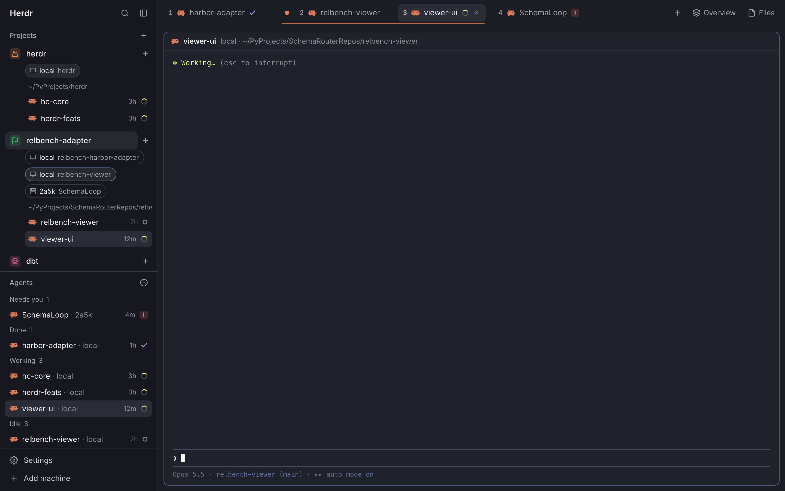

# herdr-config

English | [中文](README.zh-CN.md)

**My setup for the [Herdr](https://herdr.dev) desktop app, built for running many Claude Code sessions across several machines.**

Projects span machines and folders. The tab bar shows one project at a time, grouped by directory, and the keyboard covers the rest. One command installs it on a new Mac; one command saves changes back.



**Try it without installing:** [a clickable mock of this setup](https://claude.ai/artifact/8uu5XZMFMHJhTURieoGZEe). Press **Play** on the board. The notes beside it (English and Chinese) list what to try.

## What it does

- **Projects panel** (top left). A project is a set of *machine · directory* pairs. Each Claude conversation goes to the project that holds its directory (subdirectories follow their parent); the rest wait in Unsorted. Click a project to fold it. Click a directory's pill to list its conversations; the pill you're working in opens by itself. Drag a pill, or right-click it, to move it to another project.
- **New directory, on any machine.** The **+** on a project's row (or right-click → New directory…) asks for a machine and a path, suggests folders as you type (Tab completes), makes the directory there, adds it to the project and starts Claude in it.
- **One project's tabs at a time.** The top bar shows the current project's tabs from every space and machine, grouped by directory. A color dot and an underline mark a directory with two or more tabs. Tabs name their agents only and carry the numbers that ⌘1–⌘9 use.
- **Drag to split.** Drop a tab on another to make a split (hold ⌥ to stack them), or on an edge to reorder. To undo a split, drag a name out of the tab, right-click it, or use the button on the pane's header.
- **Background sessions count.** Sessions you `claude attach` to show up in the panel, the tab bar and the Agents list, with working or idle from a Claude Code hook.

### Keys

| Keys | What they do |
|---|---|
| ⌥1–⌥9 | Show the Nth project's tabs. Hold ⌥ to see the numbers |
| ⌘1–⌘8, ⌘9 | The Nth tab in the bar; the last tab |
| ⌃Tab, ⌃⇧Tab | Back to the pane you were in before: agents, background sessions, shells, even the other half of a split. Each card shows the last prompt and reply |
| ⌘G | Jump to the agent that last rang (needs you, or finished). Works from any app with Raycast |
| ⌘W | Close the pane, then the tab, then the space. ⌘⇧W or ⌘⇧T reopens |
| ⌘H ⌘J ⌘K ⌘L | Move between panes |

## Requirements

- macOS with the [Herdr](https://herdr.dev) app, opened once
- [GitHub CLI](https://cli.github.com) (`gh`), signed in, to clone this private repo
- Xcode Command Line Tools (`clang`), for two small helpers
- Python 3 and [Claude Code](https://claude.com/claude-code), for the hook
- Optional: [Raycast](https://www.raycast.com), for ⌘G from any app

## Install on a new Mac

```sh
gh repo clone zhuconv/herdr-config ~/herdr-config && ~/herdr-config/install.sh
```

Every file it replaces is backed up to `~/.config/herdr-app.backup-<time>/` first, and it can be run again. At the end it lists two steps to do by hand: record ⌘G for "Go to Waiting Agent" in Raycast, and allow Raycast under Accessibility.

## Remote machines

Claude sessions that run in a remote machine's Herdr terminal can fill the ⌃Tab cards and report working or idle too, once that machine has the hook (it needs `python3` there):

```sh
./install.sh --remote a5k      # machine names come from `hc machine ls`
```

Installed on a5k, 2a5k, 4vita2, 4vita5 and vista. On vista, Claude runs on a compute node, and the hook passes its labels to the login node over ssh (`$HC_VIA`, or Slurm's `$SLURM_SUBMIT_HOST` in an idev session).

## After changing the config

On the Mac where you changed it:

```sh
./save.sh          # copies the live config into the repo, commits and pushes
```

On the other Macs:

```sh
git pull && ./install.sh
```

## What's inside

| Path | What it is |
|---|---|
| `herdr-app/keys.json` | The keys above |
| `herdr-app/layouts/my-main.json` | Layout *my-main*: a soft blue-gray focus frame; my-projects above my-agents in the sidebar; my-pane headers and my-menu right-click menus |
| `herdr-app/mods/my-projects/` | The Projects panel. `model.js` holds its logic. `optwatch.c` tells it whether ⌥ is held, since a mod only sees modifier keys while it has the keyboard, which a terminal usually does; `install.sh` builds it to `~/.local/bin/herdr-optwatch` |
| `herdr-app/mods/my-tabs/` | The tab bar, with the Overview button, closes you can reopen (`reopen.js`), ⌘G (`waiting.js`) and the ⌃Tab order (`recent.js`). `projects.js` is a copy of my-projects' `model.js`, because a mod can't import from another mod's folder |
| `herdr-app/mods/agent-switcher/` | The ⌃Tab popup: a card per pane, with an agent's last prompt and reply, or a shell's folder |
| `herdr-app/mods/my-pane/` | Pane headers (a copy of Herdr's own). The split, zoom and close buttons are replaced by one, Move to new tab, shown on panes in a split |
| `herdr-app/mods/my-menu/` | Right-click menus (a copy of Herdr's own). A pane in a split gets Move to new tab; a split tab in the bar gets Move X to new tab for each name |
| `herdr-app/mods/my-agents/` | The Agents list, as "agent · space", background sessions included. `projects.js` is the same copy as in my-tabs |
| `herdr-app/mods/agent-deck-*` | The Overview panel, from [zztalker/herdr-agent-deck](https://github.com/zztalker/herdr-agent-deck) |
| `herdr-app/settings.json`, `themes/warp-dracula.json` | Font, theme, zoom, sounds |
| `claude/agent-note` | The Claude Code hook. It keeps the start of your last prompt and the end of the reply for the ⌃Tab cards, and sets `note.state` (working or idle) for background sessions, which report no state to Herdr. `install.sh` adds it to `~/.claude/settings.json` |
| `raycast/` | The Raycast script for ⌘G in any app. `postkey.c` keeps ⌘G as Find Next in VS Code |
| `install.sh`, `save.sh`, `paths.sh` | Install, save back, and the list of what's synced |

Not synced: the state Herdr writes itself (`shared.json`, `view.json`, `data/`, …) and hc's machines (add them on a new Mac with `hc machine add`).

## Credits

Project icons are from [Lucide](https://lucide.dev) (ISC license, see `herdr-app/mods/my-projects/icons/LICENSE-lucide.txt`). The Overview panel is [herdr-agent-deck](https://github.com/zztalker/herdr-agent-deck) by zztalker.
