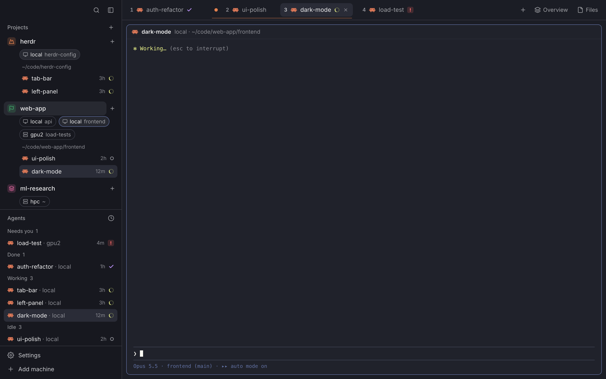

# herdr-config

[English](README.md) | 中文

**我的 [Herdr](https://herdr.dev) 桌面工作台配置——在多台 Mac、Linux 服务器与 Slurm 集群上同时并行跑 Claude Code (`cc`)、Codex 和 Antigravity (`agy`)。**

一个 Project 可跨机器、跨目录；顶部栏一次只聚焦当前 Project 的标签页（按目录分组），配合统一的跨 Agent 钩子、快捷键与远程协同 Skill 把所有会话串成一个整体。新机器上一条命令装齐，改完配置一条命令存回仓库。



> **在浏览器里直接试交互模型：** [zhuconv.github.io/herdr-config](https://zhuconv.github.io/herdr-config/) —— 支持拖动合并分屏、点击 Project 的 **+**、右键标签页和窗格体验完整交互。

---

## 三端 Agent 支持一览

| 能力 | Claude Code (`cc`) | Codex | Antigravity (`agy`) |
|---|:---:|:---:|:---:|
| 标签页、窗格标题栏与 Agents 列表实时显示对话名 | ✅（Haiku 自动起名） | ✅（自动剥离目录后缀） | ✅（`agy-title` 钩子） |
| 双击改 Tab 名 → 自动同步修改底层对话名 | ✅ | 仅改 Tab 标签 | ✅ |
| `⌃Tab` 切换卡片预览最近一轮 Prompt 与回复 | ✅ | ✅（含待审批命令提示） | ✅ |
| 完成 / 等待输入响铃弹窗 + 全局 `⌘G` 跳转 | ✅（含 `claude attach`） | ✅ | ✅ |
| `⌘⇧T` 恢复已关标签页并接回退出的对话 | ✅（`--resume`） | 恢复 Tab | ✅（`--conversation`） |
| `./install.sh --remote` 远程服务器一键部署 | ✅ | ✅（`--no-daemon` + 自动信任） | ✅ |
| 统一 Artifact 作品空间（[Yours / `artifact-site`](https://github.com/lexmount/artifact-site)） | ✅（全 `/auth` 轮换号互通） | ✅ | ✅ |
| 状态栏：模型 · 上下文用量 · 目录与 git · effort · 套餐用量 | ✅（`statusline.sh`，周额度） | ✅（内置项目 + Catppuccin Mocha 主题） | ✅（`statusline.sh`，周额度或 5 小时额度） |

---

## 功能概览（What It Does）

### 1. 跨机项目、标签栏与分屏布局

| 功能 | 作用与体验 |
|---|---|
| **跨机器 Projects 面板** | 每个 Project 由若干「机器 · 目录」组成（子目录自动继承父目录，未归类目录进 *Unsorted*）。点击折叠项目、点目录胶囊展开对话，直接拖拽胶囊即可跨 Project 移动。 |
| **单项目聚焦顶部栏** | 顶部栏只展示当前 Project 在所有 Space 与机器上的标签页，按目录聚合（同目录多标签带色点与底线标记），左侧序号直接对应 `⌘1–⌘9`。 |
| **拖拽合成分屏与拆分** | 把一个 Tab 拖到另一个上即左右分屏（按住 `⌥` 为上下分屏），拖到边缘可排序；从分屏 Tab 拖出名字、右键或点窗格右上角按钮即可拆回独立 Tab。 |
| **在任意机器新建目录** | 点击 Project 行右侧 **+**（或右键 → *New directory…*），选机器并输入路径（支持远程目录实时 Tab 补全），自动建好远程目录、归入当前 Project 并启动 Agent。 |
| **ActivityWatch 自动计时** | 将系统窗口标题设为 `Herdr — <project> · <对话> · <程序>`，每个 Project 只需一条正则（`^Herdr — paper( ·\|$)`）即可精确统计实际投入时长。 |

### 2. 三端统一的会话交互体验（`cc` · `Codex` · `agy`）

| 功能 | 作用与体验 |
|---|---|
| **一个 Agent 一个名字** | 窗格头、Tab、Agents 列表、`⌃Tab` 与系统通知统一显示真实会话名。改单 Agent Tab 名会自动同步修改 Claude / `agy` 会话名；新 Claude 会话由 Haiku 用两三个词自动概括首条消息起名。 |
| **`⌃Tab` 上下文预览卡片** | 按最近访问顺序在所有窗格（前台 Agent、后台会话、Shell、分屏另一半）间切换，卡片实时展示最近一条 Prompt、回复结尾及 Codex 待批准动作。 |
| **全局 `⌘G` 跳转与边框光晕** | 配合 Raycast 在任意 App 按 `⌘G` 直达最近响铃的窗格；目标窗格边框外亮起同色呼吸光晕后淡出，在多分屏里也能一眼定位。 |
| **退出后原位接回（`⌘⇧T`）** | 独占窗格的 Agent 退出（`Ctrl+C`、`/exit`、崩溃）时自动收起窗格；按 `⌘⇧T` 直接在原位置接回对话（`claude --resume`、`agy --conversation`），若已在别处运行则直接跳转不重开。 |
| **一键 Fork（含 Slurm 节点）** | 鼠标悬停 Claude 窗格头点 **Fork**（`--resume <id> --fork-session`）即可在旁侧分出 `<名字> (fork)` 副本——`claude attach` 后台会话及 Slurm 计算节点上的会话同样支持（副本自动开在同一计算节点上）。 |
| **后台会话感知与静默压缩** | `claude attach` 会话在 Mac 和服务器上均同步显示 *工作中 / 需要你 / 已完成* 并支持 `⌘G`；空闲自动压缩与 `/compact` 自动清掉瞬态标记，绝不误报“已完成”通知。 |
| **三端一致的状态栏** | Claude Code 和 `agy` 在输入框下显示同一行：模型（Claude 用它的陶土橙，`agy` 用蓝色）、上下文用了多少、目录与 git 分支（有改动时带 `*`）、会话时长、effort，以及套餐用量和重置时间（`agy` 显示周额度和 5 小时额度里用得多的那个）。目录前的 ⚡ 表示跳过了权限确认。Codex 用它自带的状态栏项目，顺序相同，带颜色，主题是 Catppuccin Mocha。 |

### 3. 多机 Worker 编排与远程集群控制（`hc`）

| 功能 | 作用与体验 |
|---|---|
| **跨机器派发 Worker（`hc-workers`）** | 你对话的 Claude 或 Codex 可作为 Manager，通过 `hc run` 在多台服务器或集群节点拉起并指挥 Claude/Codex Worker、处理确认提示并汇总汇报，在 Agents 列表自动挂载到 Manager 名下。 |
| **留成 Tab、Peek 与送回** | 在 Agents 列表或 Peek 预览栏点 *Keep as tab*，即可在 Manager 标签旁把远程 Worker 展开成它所在机器的独立 Tab；关掉该 Tab（`⌘W`）或点 *Send back* 只收回列表不中断运行。 |
| **关闭 Manager 前防误杀确认** | 关闭带有运行中 `hc` 子终端的窗格/Tab/Space 时自动弹窗确认，悬停按钮即标红显示哪些 Worker 会被一并终止（*Close* 保留运行 vs *End all* 连同子代一起结束，关 Tab 留宽限期可 `⌘⇧T` 撤回）。 |
| **按名字跨机查会话（`hc-find`）** | 让 Agent 按 Tab 名、会话标题、`hc` 地址或 ID 前缀在所有可达机器中定位任意 Claude 或 Codex 会话，直接读取其当前屏幕或最近几轮对话记录。 |

### 4. 多号轮换、统一 Artifact 库与升级护航

| 功能 | 作用与体验 |
|---|---|
| **Claude 会话级 / 整机账号切换** | `/auth <别名>` 仅切换当前会话及其 Subagent 使用的 `cswap` 账号（不影响同机其他会话）；`/auth-all <别名>` 切换整机；`~/.claude/mods/accounts/signin` 一键补登缺失或过期账号（账号表存于仓库外的 `~/.config/claude-accounts/accounts.json`）。 |
| **三端共用 Artifact 空间（`Yours`）** | Claude（所有 `/auth` 账号）、Codex 与 `agy` 通过 `~/.config/artifact-site`（不进仓库，`--remote` 以 `0600` 同步）读写同一个 [Yours (`artifact-site`)](https://github.com/lexmount/artifact-site) 作品库，同时禁用 Claude 内置的官方 `Artifact` 工具，换号不再丢失页面写权限。配套 `artifact-md` 将 Markdown（GFM、提示框、Mermaid、KaTeX、代码高亮）一键渲染发布或同链接原位更新。 |
| **Claude 快捷短命令** | `/ren`（`/rename`）、`/u`（`/usage`）、`/m`（`/model`）、`/st`（`/status`）敲空格即展开为完整命令，或直接回车执行。 |
| **Herdr 更新前后自动体检** | Herdr 下载新版本后标签栏自动运行 `herdr-update-check` 检查内部 API、布局格式与远程 `herdr-core` 补丁兼容性并弹通知；重启后再自检所有 Mod 是否正常加载。 |

---

## 快捷键速查

| 按键 | 作用 |
|---|---|
| `⌥1–⌥9` | 切换到第 *N* 个 Project 的标签栏（按住 `⌥` 显示编号） |
| `⌘1–⌘8`、`⌘9` | 跳到顶部栏第 *N* 个 Tab（`⌘9` 为最后一个） |
| `⌃Tab`、`⌃⇧Tab` | 按最近使用顺序在窗格间切换（带 Prompt / 回复预览卡片） |
| `⌘G` | 跳到最近响铃的 Agent（配合 Raycast 支持全局任意 App 触发） |
| `⌘W` / `⌘⇧T` (`⌘⇧W`) | 依次关闭窗格 → Tab → Space / 恢复刚关项并原位接回已退出 Agent |
| `⌘T` | 在当前 Space 新建 Tab |
| `⌘H` `⌘J` `⌘K` `⌘L` | 在分屏窗格间左 / 下 / 上 / 右移动焦点 |

> 若当前机器暂不可达（如等待 MFA 登录），`⌘T` 与 `⌘W` 会自动改为打开本机终端并在右下角提示登录命令。

---

## 快速安装与使用

### 环境要求

- **macOS**，已安装并至少打开过一次 [Herdr](https://herdr.dev)
- **Xcode Command Line Tools**（`clang`，用于编译两个轻量快捷键/修饰键辅助程序）
- **Python 3** + 你在用的任意 Agent CLI：[Claude Code](https://claude.com/claude-code)、[Codex](https://github.com/openai/codex)、Antigravity (`agy`)
- **jq**（Claude Code 和 `agy` 的状态栏要用，macOS 15 起自带）
- *可选：* **Node.js 24+**（供本机 `@artifact-site/cli` 使用；无 Node 环境下自动走内置 Python HTTP 回退）、`cswap`（`uv tool install claude-swap`，供 `/auth` 切号用）、[Raycast](https://www.raycast.com)（供全局 `⌘G` 用）

### 1. 在新 Mac 上安装

```sh
git clone https://github.com/zhuconv/herdr-config.git ~/herdr-config
~/herdr-config/install.sh
```

被替换的文件会先备份到 `~/.config/herdr-app.backup-<时间>/`，脚本支持反复幂等执行。装完只需做两步一次性系统设置：

1. **Raycast → Settings → Extensions：** 点 **+ → Add Script Directory** 添加 `~/Documents/Raycast/herdr`，给 *Go to Waiting Agent* 绑定快捷键 `⌘G`。
2. **系统设置 → 隐私与安全性 → 辅助功能：** 允许 **Raycast**（确保在 VS Code 内按 `⌘G` 依然正常触发“查找下一个”）。

### 2. 部署到远程服务器 / 集群（`hc`）

一条命令将三端 `agent-note` 钩子（`cc`、Codex `--no-daemon` 与钩子信任、`agy`）、共享 Skill（`hc-workers`、`hc-find`、`artifact-site`）、Claude 短命令与 `/auth` Mod，以及本机私有的 `~/.config/claude-accounts` 和 `~/.config/artifact-site` 凭证（`0600` 权限）同步到远程机器：

```sh
./install.sh --remote <机器名>      # 机器名来自 `hc machine ls`（远端仅需 python3）
```

在 Slurm 集群上，计算节点里的钩子会通过 SSH（`$HC_VIA` 或 `$SLURM_SUBMIT_HOST`）把会话节点信息传回登录节点，因此直接点窗格头部的 **Fork** 也能在同一个计算节点上拉起副本。

### 3. 保存与多 Mac 同步

```sh
# 在修改过配置的 Mac 上：
./save.sh                  # 将本机运行配置同步回仓库并自动 commit + push

# 在其他 Mac 上：
git pull && ./install.sh
```

### 4. 手动运行 Herdr 升级检查

除标签栏自动触发外，也可随时在终端手动检查：

```sh
herdr-update-check                 # 点 Restart 前检查待装新版本是否兼容
herdr-update-check --after         # 重启后检查所有 Mod 与远程机器状态
herdr-update-check --show before   # 查看最近一次升级前（或 `after`）完整报告
herdr-update-check --from 0.1.16 --to 0.1.17
```

---

## 目录与模块说明（What's Inside）

### Herdr 桌面端布局与 Mod（`herdr-app/`）

| 路径 | 职责说明 |
|---|---|
| `herdr-app/keys.json`、`settings.json`、`programs.json`、`themes/` | 快捷键、字体/缩放/主题（开启 `option_as_alt: "on"` 避免中文输入法拦截 `⌥1–⌥9`）及 Codex 等自定义图标。 |
| `herdr-app/layouts/my-main.json` | 主布局 *my-main*：灰蓝焦点框、精简侧边栏（`my-chrome` → `my-projects` → `my-agents`）、自定义窗格头与右键菜单。 |
| `herdr-app/mods/my-projects/` | 跨机器 Projects 面板、`optwatch.c`（`⌥` 键编号提示辅助程序）及 `title.js`（ActivityWatch 窗口标题同步）。 |
| `herdr-app/mods/my-tabs/` | 单项目标签栏、无闪烁合并分屏（`layoutdoc.js`）、Tab 改名同步会话名（`rename.js`）、关闭恢复与退出重连（`reopen.js`）、关闭 Manager 确认（`ask.js`、`workers.js`）、`⌘G` 定位计算（`waiting.js`、`glow.js`）、后台任务监听（`jobs.js`）及升级自检（`updatecheck.js`）。 |
| `herdr-app/mods/my-agents/`、`my-peek/` | Agents 列表（`agent · space`、Worker 树状挂载、机器标识、悬停 *Keep as tab*）及支持跨机器的 Worker Peek 顶栏。 |
| `herdr-app/mods/my-pane/`、`my-menu/` | 悬停显示 **Fork**（支持本机与 Slurm 计算节点）和 **Move to new tab** 的窗格头，以及分屏/Worker 右键菜单。 |
| `herdr-app/mods/my-glow/`、`my-toast/`、`my-chrome/` | `⌘G` 窗格外框呼吸光晕、带真实会话名的右下角通知、去 Logo 的紧凑侧栏顶条。 |
| `herdr-app/mods/agent-switcher/` | `⌃Tab` / `⌃⇧Tab` 最近窗格切换弹窗（展示最近 Prompt 与回复卡片）。 |
| `herdr-app/mods/agent-deck-*` | Overview 总览面板，来自 [zztalker/herdr-agent-deck](https://github.com/zztalker/herdr-agent-deck)。 |

### 跨 Agent 钩子、Mod 与共享 Skill（`agent-plugin/`）

| 路径 | 职责说明 |
|---|---|
| `agent-plugin/shared/agent-note` | **Claude Code**、**Codex**（`agent-note codex`）与 **Antigravity**（`agent-note antigravity` + `agent-note agy-title`）共用的核心钩子：维护 `⌃Tab` 卡片、追踪 `claude attach` 后台状态、记录计算节点主机名供 Fork 使用，并屏蔽空闲压缩假提醒。 |
| `agent-plugin/shared/artifact-site-mcp`、`artifact-md`、`add-artifact-site.py` | 三端共用的 [Yours (`artifact-site`)](https://github.com/lexmount/artifact-site) 接入：本地 stdio MCP 启动器（优先调 Node 24 CLI，无 Node 服务器自动回退纯 Python 3.9+ HTTP 转发）、Markdown/Mermaid/KaTeX 单页渲染发布器（`artifact-md`），以及幂等三端配置与内置 `Artifact` 禁用脚本。 |
| `agent-plugin/shared/skills/hc-workers/`、`hc-find/` | 跨机器 Worker 调度（含 Slurm 集群指南 `vista.md`）与按名查找会话/读取记录的共享 Skill，统一装入 `~/.agents/skills/` 并软链至 `~/.claude/skills/`。 |
| `agent-plugin/claude/` | Claude Code `short-names` Mod（短命令别名 + Haiku 自动起名）、`accounts` Mod（`/auth`、`/auth-all`、`signin`、`#acct=` 链接标）、状态栏脚本 `statusline.sh`（Claude Code 没传用量时，最多一分钟问一次 Anthropic 的用量接口）及 `settings.json` 安装脚本（状态栏那个会保留你自己设的状态栏）。 |
| `agent-plugin/codex/` | Herdr 终端内自动加 `--no-daemon` 的 Shell 包装（`codex.sh`）、钩子注册与 `codex-hooks-trust` 自动信任工具。`tui.toml` 存它的状态栏项目和主题：`add-statusline.py` 把它们写进 `~/.codex/config.toml` 的 `[tui]`（`install.sh`），也抄回仓库（`save.sh`），这个文件的其余内容不进仓库。 |
| `agent-plugin/antigravity/` | 为 `agy` 自动配置 `~/.gemini` 下的 `agent-note` 钩子、会话名终端标题命令与状态栏（`statusline.sh`，由 `add-statusline.py` 设置）。 |

### 安装同步与辅助脚本

| 路径 | 职责说明 |
|---|---|
| `install.sh`、`save.sh`、`paths.sh` | 本机与 `--remote <机器>` 幂等安装脚本、配置回写推送脚本及同步清单（Herdr 运行态 `shared.json`/`view.json`/`data/`、机器连接以及私有账号/Token 均留在仓库外）。 |
| `update-check.py` | `herdr-update-check`：对比当前与待更新 Herdr 版本的源码及远程 `herdr-core` 兼容性。 |
| `raycast/` | 全局 `⌘G` 跳转脚本与 `postkey.c`（在 VS Code 内把 `⌘G` 原样透传给“查找下一个”）。 |
| `docs/`、`tests/` | GitHub Pages 在线交互模型（[zhuconv.github.io/herdr-config](https://zhuconv.github.io/herdr-config/)）与 Node / Python 自动化测试集。 |

---

## 致谢

Project 图标来自 [Lucide](https://lucide.dev)（ISC 许可，见 `herdr-app/mods/my-projects/icons/LICENSE-lucide.txt`）。Overview 面板来自 zztalker 的 [herdr-agent-deck](https://github.com/zztalker/herdr-agent-deck)。浏览器交互模型基于 [Preact](https://preactjs.com)（MIT 许可，见 `docs/LICENSE-preact.txt`）。
