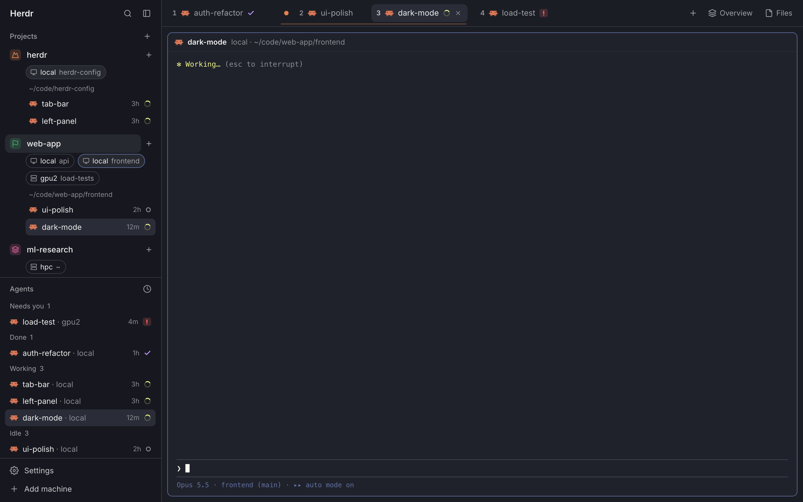

# herdr-config

[English](README.md) | 中文

**我的 [Herdr](https://herdr.dev) 桌面版配置，为在好几台机器上同时跑很多个 Claude Code 会话而做。**

一个 project 可以跨机器、跨目录。顶部 tab 栏一次只显示一个 project，按目录分组，其余靠快捷键。新电脑上一条命令装好，改完一条命令存回仓库。



**在浏览器里试：**[zhuconv.github.io/herdr-config](https://zhuconv.github.io/herdr-config/) 是这套配置的可点击模型，用的是示例名字。把 tab 拖到一起、点 project 的 **+**、到处右键试试；角落里的卡片写了可以试哪些操作。

## 能做什么

- **Projects 面板**（左上）。一个 project 由若干个"机器 · 目录"组成。每个 Claude 对话归到包含它所在目录的 project（子目录跟父目录走），没归类的在 Unsorted。点 project 那一行折叠/展开。点目录胶囊列出它的对话；你所在的那个胶囊会自己打开。拖动胶囊，或右键它，可以挪到别的 project。
- **在任意机器上新建目录。** project 那一行右边的 **+**（或右键 → New directory…）：选机器、填路径，边输入边提示那台机器上的文件夹（Tab 补全），在那台机器上建好目录、加进这个 project，并在里面开 Claude。
- **一次只看一个 project 的 tab。** 顶部栏显示当前 project 在所有 space、所有机器上的 tab，按目录分组。一个目录有两个以上 tab 时，前面一个色点、下面一条细线。tab 上只写 agent 的名字，左边的编号就是 ⌘1–⌘9 用的号。
- **拖动分屏。** 把一个 tab 拖到另一个上面合成分屏（按住 ⌥ 是上下分），拖到边缘是排序。拆回来：把名字从分屏 tab 里拖出来、右键它，或者点窗格标题栏上的按钮。
- **后台会话也算。** 用 `claude attach` 打开的会话也出现在面板、tab 栏和 Agents 列表里，状态和前台 agent 一样：工作中、需要你、做完了（看过之前一直显示）。做完或需要你时，弹 Herdr 同样的提示、响同样的声音，⌘G 也能跳过去。状态取自 Claude Code 自己给每个会话记的记录，Mac 上的和服务器上的都算（`./install.sh --remote <机器>` 把 hook 装到服务器上）。

### 快捷键

| 按键 | 作用 |
|---|---|
| ⌥1–⌥9 | 显示从上往下第 N 个 project 的 tab。按住 ⌥ 能看到编号 |
| ⌘1–⌘8、⌘9 | 栏里第 N 个 tab；最后一个 tab |
| ⌃Tab、⌃⇧Tab | 回到你上一个待过的窗格：agent、后台会话、shell，甚至分屏的另一半都算。每张卡片显示最近的 prompt 和回复 |
| ⌘G | 跳到最近响铃（需要你，或者做完了）的 agent。配合 Raycast 在任何 app 里都能用 |
| ⌘W | 先关窗格，再关 tab，最后关 space。⌘⇧W 或 ⌘⇧T 恢复 |
| ⌘T | 在当前 space 新开一个 tab |
| ⌘H ⌘J ⌘K ⌘L | 在窗格之间移动 |

如果当前机器连不上（比如在等登录），⌘T 和 ⌘W 在那台机器上做不了事，就改为打开一个本机终端，并在右下角提示登录命令。

## 需要什么

- macOS，装好 [Herdr](https://herdr.dev) 并打开过一次
- 登录好的 [GitHub CLI](https://cli.github.com)（`gh`），用来 clone 这个私有仓库
- Xcode Command Line Tools（`clang`），编译两个小程序
- Python 3 和 [Claude Code](https://claude.com/claude-code)，给 hook 用
- 可选：[Raycast](https://www.raycast.com)，让 ⌘G 在任何 app 里都能用

## 新电脑上安装

```sh
gh repo clone zhuconv/herdr-config ~/herdr-config && ~/herdr-config/install.sh
```

会被替换的文件先备份到 `~/.config/herdr-app.backup-<时间>/`，可以重复运行。最后它会列出两步需要手动做的事：在 Raycast 里给 "Go to Waiting Agent" 录 ⌘G，以及在辅助功能里允许 Raycast。

## 远程机器

在远程机器的 Herdr 终端里跑的 Claude 会话，也能填 ⌃Tab 卡片、显示工作中/空闲，前提是那台机器装了 hook（那台需要有 `python3`）：

```sh
./install.sh --remote <机器名>      # 来自 hc machine ls；每台机器跑一次
```

在 Slurm 集群上，Claude 跑在计算节点上，hook 通过 ssh 把标签交给 login 节点（`$HC_VIA`，或 idev 里 Slurm 给的 `$SLURM_SUBMIT_HOST`）。

## 改了配置之后

在改过的那台电脑上：

```sh
./save.sh          # 把当前配置拷回仓库，commit 并 push
```

其他电脑：

```sh
git pull && ./install.sh
```

## 里面有什么

| 位置 | 内容 |
|---|---|
| `herdr-app/keys.json` | 上面那些快捷键 |
| `herdr-app/layouts/my-main.json` | 布局 my-main：灰蓝色焦点框；左栏上面 my-projects、下面 my-agents；窗格标题栏用 my-pane，右键菜单用 my-menu |
| `herdr-app/mods/my-projects/` | Projects 面板，逻辑在 `model.js`。`optwatch.c` 是个小程序，`install.sh` 把它编译到 `~/.local/bin/herdr-optwatch`：它告诉左栏 ⌥ 有没有按住，也告诉 tab 栏拖到栏下面的拖动什么时候松手，因为 mod 只有拿到键盘焦点才知道修饰键（焦点通常在终端里），鼠标也只有在 mod 上方时才听得到。它只在 Herdr 是前台 app 时运行 |
| `herdr-app/mods/my-tabs/` | tab 栏，还有 Overview 按钮、关闭后可恢复（`reopen.js`）、⌘G（`waiting.js`）和 ⌃Tab 的顺序（`recent.js`）。`jobs.js` 从 `~/.claude/jobs` 里 Claude Code 的记录得出后台会话（`claude attach`）的状态，是监听文件变化，不是轮询：tab 栏把状态写到会话所在终端的 `note.job` 标签上，其他面板读这个标签；响铃规则和 Herdr 一样。服务器上的会话来自 hook 在那边写的 `note.bg` 标签，从 Herdr 自己的终端列表里读（Herdr 不在前台时不重画，所以那时每 2 秒看一次）。`layoutdoc.js` 合并两个 tab 时，一次改写那台机器的布局，所以出来就是分好屏的样子；Herdr 的命令只能在当前焦点窗格旁边分屏，那样得先单独显示目标 tab。这个布局格式不是公开接口，哪天变了，合并会退回用那些命令。`projects.js` 是 my-projects 的 `model.js` 的拷贝，因为 mod 不能引用别的 mod 的文件 |
| `herdr-app/mods/agent-switcher/` | ⌃Tab 弹窗：每个窗格一张卡片，agent 显示最近的 prompt 和回复，shell 显示所在目录 |
| `herdr-app/mods/my-pane/` | 窗格标题栏（Herdr 自带的拷贝）：分屏、全屏、关闭这几个按钮换成一个 Move to new tab，只在分屏里的窗格上出现 |
| `herdr-app/mods/my-menu/` | 右键菜单（Herdr 自带的拷贝）：分屏里的窗格多一项 Move to new tab；顶部栏里分屏的 tab，每个名字有一项 Move X to new tab |
| `herdr-app/mods/my-toast/` | 右下角的通知（Herdr 自带的拷贝）：agent 做完或需要你时，提示里用 Agents 列表里的名字（你给 tab 起的名字，否则是会话的名字），而不是“Claude Code”。`projects.js` 同样是 my-projects 的 `model.js` 的拷贝 |
| `herdr-app/mods/my-agents/` | Agents 列表，显示成 "agent · space"，后台会话也在里面。`projects.js` 和 my-tabs 里的是同一份拷贝 |
| `herdr-app/mods/agent-deck-*` | Overview 面板，来自 [zztalker/herdr-agent-deck](https://github.com/zztalker/herdr-agent-deck) |
| `herdr-app/settings.json`、`themes/warp-dracula.json` | 字体、主题、缩放、提示音。`option_as_alt: "on"` 让 Option 在任何输入法下都当 Alt 用：用中文输入法的中文模式时，Herdr 默认把 ⌥1 交给输入法，于是打出字来，而不是切换 project |
| `claude/agent-note` | Claude Code hook：记下你最近一条 prompt 的开头和回复的结尾，给 ⌃Tab 卡片用；同时给后台会话打 `note.state` 标签（工作中/空闲），因为它们不向 Herdr 报告状态；Herdr 没在看它们的记录时用这个兜底。在服务器上它还写 `note.bg`：Claude 记下的这个回合怎么结束的，给 Mac 上的 tab 栏用。用 resume 接回的对话，卡片会马上从对话记录里补上。后台会话的记录写到每个显示它的终端上：`claude attach <id>`，或者标题是该会话名字的 `claude --resume` 窗口。（它带的 `$HC_TERMINAL_ID` 是后台服务的，所以不用。）`install.sh` 会把它加进 `~/.claude/settings.json` |
| `raycast/` | 任何 app 里按 ⌘G 的 Raycast 脚本；`postkey.c` 让 VS Code 里的 ⌘G 照常是"查找下一个" |
| `install.sh`、`save.sh`、`paths.sh` | 安装、存回仓库，以及同步哪些文件的清单 |
| `docs/` | 可点击模型（GitHub Pages 发布）和截图。`index.html` 是设计画布的文件换成示例名字后的版本；`support.js` 用 [Preact](https://preactjs.com) 让它跑起来 |

不同步的：Herdr 自己写的状态（`shared.json`、`view.json`、`data/` 等）和 hc 的机器配置（新电脑上用 `hc machine add` 加）。

## 致谢

project 图标来自 [Lucide](https://lucide.dev)（ISC 许可，见 `herdr-app/mods/my-projects/icons/LICENSE-lucide.txt`）。Overview 面板是 zztalker 的 [herdr-agent-deck](https://github.com/zztalker/herdr-agent-deck)。模型页用了 [Preact](https://preactjs.com)（MIT，见 `docs/LICENSE-preact.txt`）。
